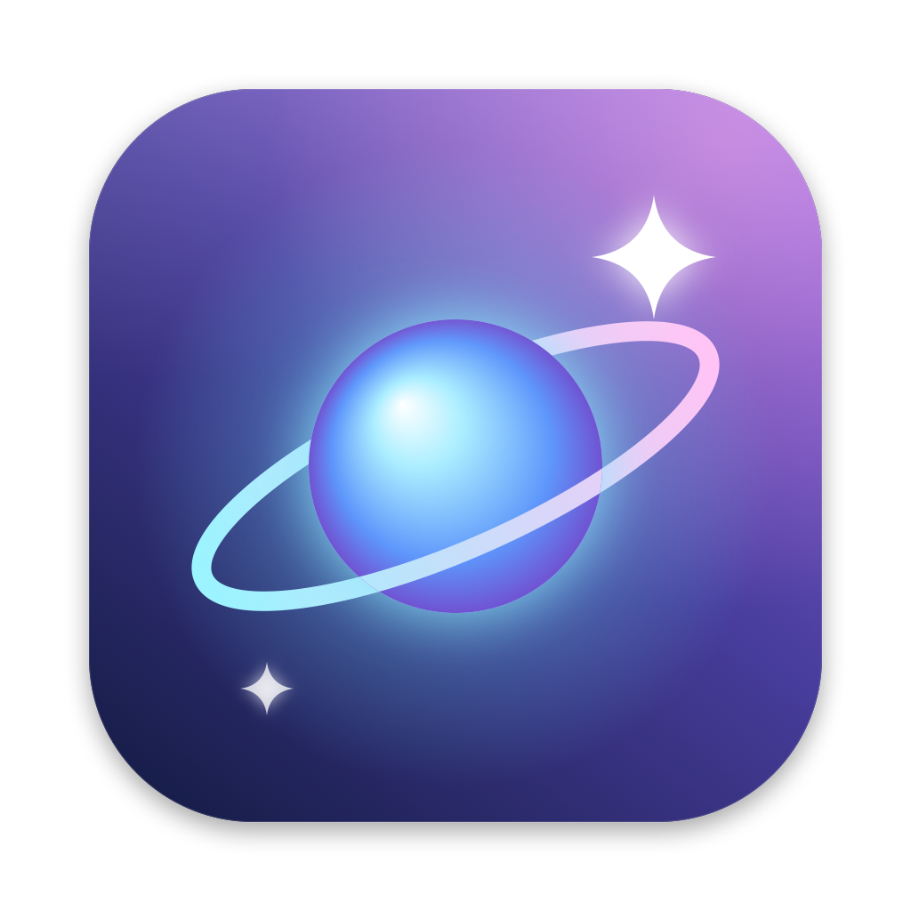

<p align="center"></p>

<h1 align="center">截图翻译视频下载</h1>

<p align="center">一个常驻 Mac 桌面的小工具：<b>整屏变中文 · 截图中转站 · 中英互译 · 无水印视频下载 · 原画质片段截取</b><br>免费、开源、不用注册，所有截图识别都在本机完成。</p>

---

## 为什么做这个

我平时做内容、剪视频，每天都在这几件事之间来回切：

- 看英文网页、英文软件、YouTube，**想一眼看懂整个屏幕**，而不是一句句复制去翻译；
- 截了很多图，要**挑几张拖进聊天框、文档、剪辑软件**，桌面却越堆越乱；
- 在搜索框、聊天框里**打好中文想马上换成英文**；
- 看到抖音、B站、YouTube、小红书上的好视频，想**原画质、无水印存下来**做参考；
- 有时只想要博主视频里**几秒钟好看的动效**，还要保持原来的画质。

市面上这些功能分散在好几个软件里，有的收费、有的要登录、有的会把截图传到服务器。所以我把它们做进了一个桌面小球里：**点一下就能用，不用切来切去**。

## 功能一览

| 功能 | 怎么用 | 说明 |
|---|---|---|
| **整屏变中文** | 菜单栏「全屏中文」按钮，或 ⌥T | 屏幕上的英、日、韩、法、德、西、俄等外文都盖上中文；滚动、翻页、切窗口自动跟着翻；再点一次恢复原文 |
| **翻译框** | ⌥A | 粘贴或输入就**自动翻译**（中文→英文，其他→中文）；截图直接 ⌘V 粘进去或拖进去，自动识别图上的字再翻 |
| **翻译选中文字** | ⌥D | 任何软件里选中外文，鼠标旁弹出中文 |
| **框选翻译** | ⌥S | 拖框选屏幕任意区域（图片、视频字幕、按钮都行），识别并翻译 |
| **输入框中→英** | ⌥E | 在搜索框、聊天框打好中文，按一下就换成英文，⌘Z 可撤销 |
| **截图中转站** | ⌥Z 打开，⌥X 直接截 | 系统截图自动收进来；**在空白处按住拖出选框多选**，选好后直接拖到任何地方；Delete 删除 |
| **视频下载** | ⌥V，或把链接拖到小球上 | 抖音（视频 / 图文）、B站、YouTube、小红书、TikTok、微博、X、Instagram 等上千个网站；自动选最高画质，合成剪辑软件能直接用的 MP4 |
| **片段截取** | ⌥C | 只要视频里的一段：逐帧选起止点，原画质导出（近无损 H.264 / 无损直拷 / ProRes）；还能框选抹掉水印 |
| **换小球形象** | 点小球 →「换个形象」 | 选一张自己的图片，自动抠出人物 / 宠物 / 物品做成带白边的贴纸，代替默认圆球 |

## 安装

需要 macOS 14 或更新（Apple 芯片）。

1. 下载本仓库（右上角 **Code → Download ZIP**，或 `git clone`）。
2. 双击 **`安装.command`**。第一次会提示安装苹果的「命令行开发工具」，装好后再双击一次。
3. 装好后：桌面右侧出现小球，菜单栏出现「译」和「全屏中文」。
4. 打开两个权限（**只需一次，以后更新不用重新开**）：
   - 系统设置 → 隐私与安全性 → **录屏与系统录音** → 打开「截图翻译视频下载」（整屏翻译、框选翻译要用）
   - 系统设置 → 隐私与安全性 → **辅助功能** → 打开「截图翻译视频下载」（读取选中文字、改写输入框要用）

**视频下载 / 片段截取**还需要两个免费的命令行工具：

```bash
brew install yt-dlp ffmpeg
```

没装 yt-dlp 的话，第一次下载时软件会自动从 yt-dlp 官方 GitHub 下载。想让 YouTube 下载更快，再装一个 JS 运行环境（`brew install deno` 或 Node.js 任选一个）。

## 使用方法

### 整屏变中文
点菜单栏「**全屏中文**」（按钮变蓝 = 开着），整个屏幕的外文都会盖上中文；再点「恢复原文」关掉。译文层不挡操作，照常点下面的内容。看 YouTube 时字幕也会跟着翻，大约晚 1 秒。

### 翻译框（⌥A）
- 粘贴一段英文 → 立刻出中文；粘贴中文 → 出英文。打字时停顿一下也会自动翻。
- 截一张英文图（比如 ⌘⌃⇧4 截到剪贴板），在框里 ⌘V；或把图片文件拖进来 → 自动识别文字并翻译。
- 右上角可以指定翻译引擎；「朗读原文」听发音；「固定」后点别处不会关。

### 截图中转站（⌥Z）
- 用 ⌘⇧3 / ⌘⇧4 / ⌘⇧5 截图会自动复制一份进来（桌面原图不动）；⌥X 截的图直接进来，不放桌面。
- **在图片之间的空白处按住鼠标拖出选框**，框住的都会选上（按住 ⌘ 可以在已选的基础上加减）。
- 按住任意一张选中的图，**直接拖**到聊天框、文档、网页上传框、剪辑软件里。
- 按 **Delete** 删除选中的（进废纸篓，删错能找回）；⌘A 全选，⌘C 复制，Esc 取消选择。
- 「翻译图上的字」：识别选中图片里的文字并翻译。

### 视频下载（⌥V）
1. 在 App 里「分享 → 复制链接」，整段分享文字粘进来就行，链接会自动认出来；也可以把链接拖到桌面小球上。
2. 选画质：原画质（最高）/ 1080p 以内 / 只要声音（MP3）。
3. B站 4K、大会员画质或需要登录的视频：选「用 Safari / Chrome / Edge / Firefox 的登录」（读取你自己浏览器的登录状态，不经过任何第三方）。
4. 文件存到「下载 / 截图翻译视频下载」。下载完可以直接点「截片段 / 去水印」。

关于水印：
- **抖音**：直接取作品的无水印原始文件。
- **YouTube**：本来就没有水印。
- **B站**：如果 UP 主开了「添加水印」，B站会把水印**压进画面本身**，任何下载方式拿到的都带着。可以用「片段截取」框选抹掉。

### 片段截取（⌥C）
专门为「看到别人好看的动效，只想要那几秒」设计：
1. 粘贴链接（会先按原画质下载）或把本地视频拖进窗口。
2. 播放到开始处按 **I**（设为起点），到结束处按 **O**（设为终点）；空格播放/暂停，播放器有逐帧按钮；也可以直接输入 `1:23.5`。
3. 有水印：点「框选水印」在画面上拖框，勾「抹掉框里的水印」。
4. 选格式导出，存到「下载 / 截图翻译视频下载 / 片段」：

| 格式 | 画质 | 速度 | 适合 |
|---|---|---|---|
| 精确到帧 · 接近无损（默认） | H.264 CRF 12，肉眼看不出差别 | 快 | 绝大多数情况 |
| 原画质无损 · 极快 | 和原片完全一样（直接拷贝数据） | 瞬间 | 不在乎起点早几帧（会对齐到关键帧） |
| ProRes 422 HQ | 剪辑级 10-bit | 快，文件大 | 拖进 Final Cut / Premiere / 达芬奇 |

### 换小球形象
点小球 →「换个形象（用自己的图片）…」，选一张图片。软件用 macOS 自带的主体识别把人物 / 宠物 / 物品抠出来，描上一圈白边，变成桌面贴纸；认不出主体时做成圆形头像。整屏翻译开着时，贴纸右下角会出现一个蓝色「中」。「恢复默认圆球」可以换回来。

## 隐私

- 截屏、文字识别（OCR）、抠图全部在**本机**完成，图片不会上传。
- 下载了苹果离线翻译包时（菜单栏「译」→「下载离线翻译包」），翻译也完全在本机；没下载时，只有识别出来的**文字**会发给必应翻译（失败时用谷歌、MyMemory）。
- 微信、QQ、企业微信、钉钉、Telegram、邮件、钥匙串、1Password 等聊天 / 邮件 / 密码类窗口**完全不截取、不识别**；浏览器里的网页邮箱、网页聊天同样跳过；输入密码时整屏翻译自动暂停。
- 不收集任何数据，没有账号系统。

## 技术实现

纯 Swift + AppKit，没有第三方 Swift 依赖，一条 `swiftc` 命令编译。

| 模块 | 文件 | 用到的技术 |
|---|---|---|
| 菜单栏、快捷键、翻译框 | `src/main.swift` | Carbon 全局热键、辅助功能 API 读选中文字 |
| 翻译引擎 | `src/Translator.swift` | 苹果 Translation 框架（离线）→ 必应网页翻译 → 谷歌 → MyMemory，失败自动切换并短暂跳过；整屏翻译按语言分组批量翻 |
| 整屏翻译、桌面小球 | `src/ScreenTranslate.swift` | ScreenCaptureKit 截屏（排除私密窗口）、Vision 分块并行 OCR、画面指纹只重认变化区域、按周围颜色铺底的覆盖层 |
| 截图中转站 | `src/Shelf.swift` | Spotlight 监听系统截图、框选多选、多文件拖拽 |
| 视频下载 | `src/Downloader.swift` | 抖音分享页解析无水印地址；其他网站调用 yt-dlp（自动带上系统代理、JS 运行环境、8 路分片并发） |
| 片段截取 | `src/ClipEditor.swift` | AVKit 预览、ffmpeg 精确裁剪 / 无损拷贝 / ProRes、delogo 抹水印 |
| 小球形象 | `src/Avatar.swift` | Vision 前景主体分割 + Core Image 描白边 |
| 离线翻译包 | `src/LanguagePack.swift` | SwiftUI `translationTask` 触发系统下载语言包 |
| 图标 | `icon/make_icon.swift` | Core Graphics 代码绘制，`iconutil` 生成 icns |

一些设计上的取舍：
- **签名固定身份**：安装脚本用 `codesign -r='designated => identifier …'` 签名，这样重新编译后系统权限不会失效（普通的临时签名每次编译都会变，权限就丢了）。
- **代理**：从「应用程序」启动的进程拿不到终端里的代理变量，所以下载前主动读取系统代理设置传给 yt-dlp，国内用 Clash 等代理时速度差别很大（实测直连 30 KB/s，走代理 1–6 MB/s）。
- **翻译速度**：原来依赖的微软免费接口已停用、谷歌在国内会弹验证码，每次都要白等超时；现在先用本机离线翻译，再用国内可直连的必应，连不上的引擎会被暂时跳过。

## 常见问题

- **整屏翻译点了没反应 / 弹出要权限**：去「录屏与系统录音」里打开它；如果开关已经开着却不行，先点「−」删掉再「+」加回来。
- **某个网站突然下载不了**：网站改版了，点下载窗口右下角「更新下载组件」。
- **YouTube 很慢**：YouTube 走的是你的代理线路，速度取决于代理；装上 deno 或 Node.js 可以避免被 YouTube 限速。
- **快捷键没反应**：可能被别的软件占用了，启动时会提示；也可以用菜单栏「译」里的菜单。
- **卸载**：菜单栏「译」→ 退出，把「应用程序」里的「截图翻译视频下载」移到废纸篓。

更详细的说明见 [使用说明.md](使用说明.md)。

## 声明

视频下载与片段截取功能仅供个人学习、收藏和参考。请尊重原作者的版权，下载的内容未经授权不要二次发布或商用；抹水印功能是为了个人素材整理，不要用来冒充原创。

## License

[MIT](LICENSE) © zurenze1
